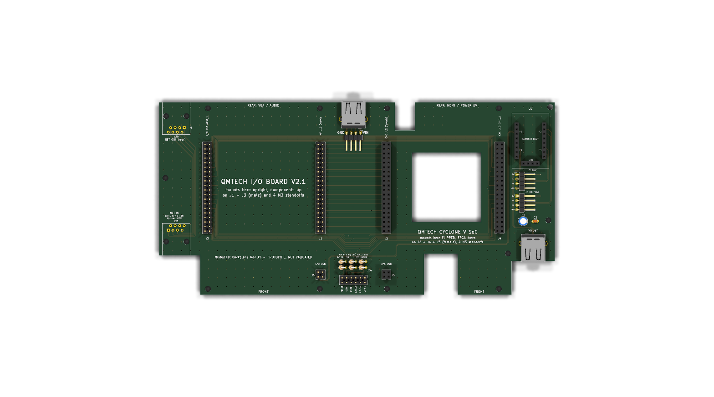

# MiSTerFlat

Everything for my flat MiSTer FPGA: the boards, the display, the web manager and the helper
scripts, in one repository.

| Folder | What it is |
|---|---|
| [`hardware/`](hardware) | The flat backplane (Rev A5) and the front panel board. KiCad projects generated by Python scripts, Gerbers, mechanical drawings. |
| [`display/`](display) | MiSTerLily: the colour status display (ESP32-S3 firmware, MiSTer daemon, installer). Website: https://alberthorta.github.io/MiSTerFlat/ |
| [`manager/`](manager) | MiSTerManager: the web page that runs on the MiSTer (games, saves, settings, display, power). |
| [`art/`](art) | Personal scripts that make the colour core pictures for the display. The pictures are not in git. |
| [`roms/`](roms) | Scripts that build MiSTer arcade ROM zips from my own ROM collection. |

Each folder has its own README with the details.

## Releases

Tags `v*` are MiSTerLily releases (firmware for every board plus `misterlily_install.sh`). The
updaters on the MiSTer read the latest release, so other parts of the repository do not use
`v*` tags. See [`.github/workflows/release.yml`](.github/workflows/release.yml).

`mister` in the root is a link to `display/mister`. MiSTerLily updaters older than this
repository look for `mister/` in the root; keep the link so they can update.

## Licence

MiSTerLily is GPL-3.0 ([`display/LICENSE`](display/LICENSE)).
