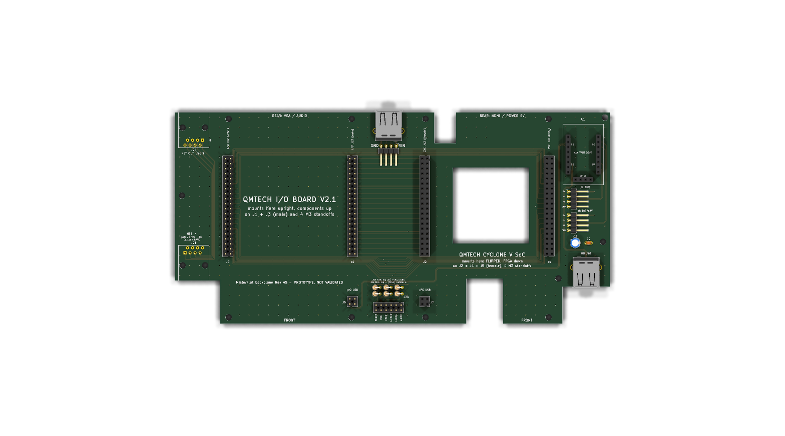
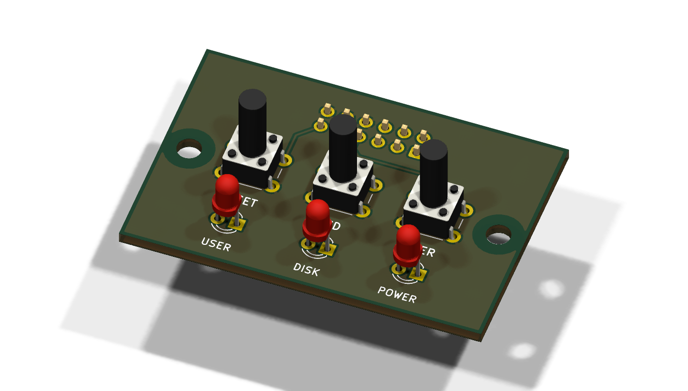

# MisterFlat

A flat backplane that puts a QMTECH Cyclone V SoC board and its I/O Board
V2.1 side by side, instead of stacked. Used for MiSTer FPGA in a flat case.

**Status: Rev A5, prototype.** A 1:1 print was checked against the real
QMTECH boards (pins, holes, notches, JP6 pinout). See
[docs/RevA5_design_notes.md](docs/RevA5_design_notes.md).



- I/O Board on the left, upright, on two 2x20 male headers.
- Cyclone on the right, flipped (FPGA faces the backplane), on two 2x20
  female sockets. There is a window under the FPGA for the heatsink.
- J12 and J10 (GPIO_1) are passed through pin for pin.
- The Cyclone JP6 USB feeds an Adafruit 5997 (CH334F) hub. Its outputs
  go to the I/O Board, a display header, an AUX header and a USB-A for
  the Wi-Fi/BT dongle.
- A network extension on the left brings the Cyclone RJ45 (front) to the
  rear, through a short patch cable and two RJ45 jacks.
- A small front panel board (`PanelRevA/`) holds 3 buttons and 3 LEDs.
  A 12-wire IDC ribbon connects it to J24 on the backplane.



## Layout

| Path | Content |
|---|---|
| `RevA5/` | KiCad 10 project (schematic, PCB, project library) |
| `RevA5/reports/` | ERC, DRC, schematic PDF, PCB layer PDFs, BOM |
| `PanelRevA/` | Front panel board, KiCad project, reports, fab and STEP |
| `tools/design.py` | All geometry, parts and nets. Edit this file. |
| `tools/build_sch.py` | Writes the schematic and the symbol library |
| `tools/build_pcb.py` | Writes the PCB, the hub footprint and all routing |
| `tools/build_panel.py` | Writes the front panel board (schematic and PCB) |
| `tools/verify.py` | Pin-for-pin, position and length checks |
| `tools/make_outputs.sh` | Runs everything and writes all outputs of both boards |
| `docs/` | Audit of Rev A4, design notes, changelog, images |
| `handoff/` | The original package (QMTECH sources, Rev A4). Local only, not in git |
| `refs/` | Adafruit CH334F Eagle files |

## Regenerate

The KiCad files are generated. Change `tools/design.py` (or the build
scripts), then run from this `hardware/` folder:

```sh
tools/make_outputs.sh
```

It builds both boards, runs `verify.py`, ERC and DRC, and writes:

- `RevA5/fab/` and `PanelRevA/fab/`: Gerber zips for JLCPCB (see
  `RevA5/fab/README_fab.md`).
- `*/reports/`: ERC, DRC, schematic PDF, BOM and a 1:1 A4 print.
- `RevA5/mech/`: mechanical PDF (A3, 1:1, page 5 is the front panel) and
  STEP. `PanelRevA/mech/`: STEP of the front panel board.

If you edit the board by hand in KiCad, the next build overwrites it.
After the design is frozen, hand edits are fine; from then on, stop
using the scripts.
