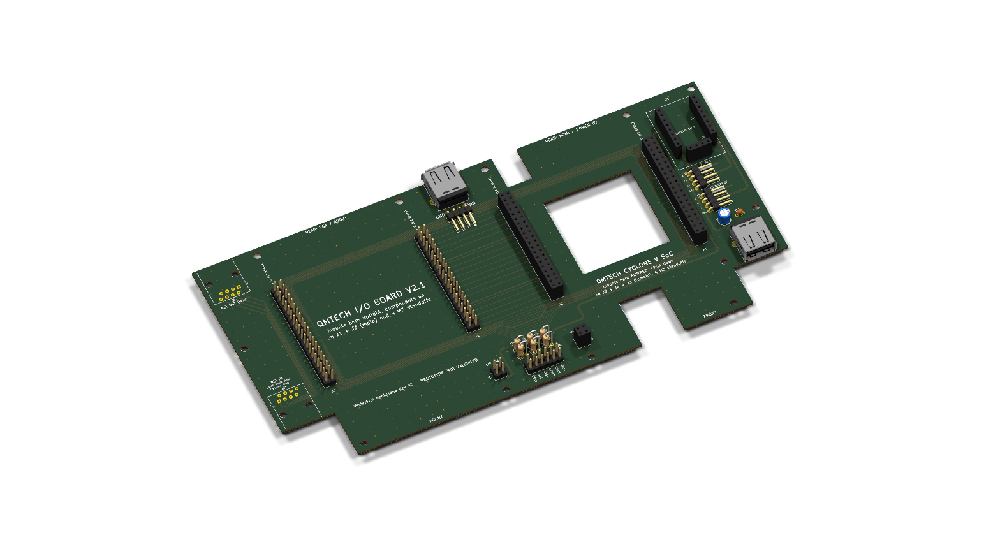

# MisterFlat backplane Rev A5: design notes

Status: **prototype, not validated, do not fabricate.** ERC, DRC and the
pin-for-pin checks pass, but several inputs are still estimates. See
"Before fabrication" at the end.



## 1. Coordinate system

KiCad board coordinates in mm. Rear is y = 20 (Cyclone: HDMI / JP7, I/O Board: VGA / audio), front is
y = 126.91. Seen from the top of the backplane.

The QMTECH base drawing uses `d` (mm from the HDMI/JP7 edge) and `e`
(mm from the J12 edge). The values come from the vector PDF
(`QMTECH_Cyclone_V_SoC_KFB_Dimension_Top_20240607_V01.pdf`).

| Board | Transform | Why |
|---|---|---|
| I/O Board V2.1, upright | `x = 20 + 68.58 - e`, `y = 20 + d` | Same top view as in the original stack. Its VGA / audio side is at the rear |
| Cyclone V, flipped | `x = 119.58 + e`, `y = 20 + d` | Mirrored about the front–rear axis, so HDMI stays at the rear |

Gap between the two boards: 31.00 mm (`GAP` in `tools/design.py`).
It was 21 mm. On the real boards the Cyclone microSD slot faces the I/O
J12, so the gap grew by 10 mm to leave finger room for the card. The
rear USB-A (J22 + J23), the front panel header J24 and its resistors
stay centred in the gap (x = 104.08).

Note: some absolute x values later in this document were written for
the 21 mm gap. Everything right of the gap (Cyclone, notches, hub, J7,
J8, J9, H9-H11) is now 10 mm further right. `tools/design.py` and the
mechanical PDF have the current values.

Result: both J12 connectors are in the middle, next to each other. Both
J10 (GPIO_1) connectors are at the outer edges. Every pin N has the same
y on both connectors of a pair. The layout is mirror symmetric about
x = 104.08. `tools/verify.py` checks all of this.

The script places the footprints and then finds the rotation that puts
every pad on its QMTECH position. If no rotation fits, the build stops.
Result: J1/J2 rotation 0, J3/J4 rotation 180, J5 270, J6 90. The
maximum position error is 0.0000 mm against the drawing.

## 2. Connectors

| Ref | Part | Position (pin 1) | Notes |
|---|---|---|---|
| J1 | 2x20 male, vertical | (84.517, 43.29) | I/O J12 |
| J2 | 2x20 female, vertical | (113.643, 43.29) | Cyclone J12 |
| J3 | 2x20 male, vertical | (24.063, 91.55) | I/O J10 (GPIO_1) |
| J4 | 2x20 female, vertical | (174.097, 91.55) | Cyclone J10 (GPIO_1) |
| J5 | 2x2 female | (113.643, 116.95) | Cyclone JP6: 1 DM, 2 5V, 3 DP, 4 GND |
| J6 | 2x2 male | (84.517, 116.95) | **Provisional.** Mirror of JP6 for the I/O Board |
| U1 | Adafruit 5997 on sockets | centre (192.5, 41.24) | 2x 1x8 + 1x4 female sockets |
| J7 | 1x4 male, 90 deg | (185.0, 60.0) | AUX, pins point to the right edge but stay inside |
| J8 | 1x4 male, 90 deg | (185.0, 72.0) | DISPLAY (T-Display-S3), same as J7 |
| J9 | USB-A, Molex 67643 | pin 1 (190.5, 95.71) | Wi-Fi/BT dongle, face 0.5 mm into the notch |
| J22 | USB-A, Molex 67643 | pin 1 (102.58, 31.99) | Rear USB between the boards, face 1 mm past the rear edge |
| J23 | 1x4 male, 90 deg | pin 1 (102.89, 36.7) | Rear USB cable header right behind the USB-A, pins face the front: VIN, D-, D+, GND from east |
| J24 | 2x6 boxed IDC header, vertical | pairs x 97.73 .. 110.43 (centred in the gap, x 104.08), rows y 117.5 / 120.04 | Front panel buttons and LEDs (section 2c) |
| R1–R6 | 1/4 W through-hole, standing | 2 rows of 3, centred on x 104.08; rows y 108.6 (R1–R3) and 111.75 (R4–R6) | 10 kΩ button pull-ups, 1 kΩ LED resistors |

Pin order on J7/J8: 1 = 5V, 2 = D-, 3 = D+, 4 = GND.

Nothing on J7/J8 sticks out of the board. The pins end at x = 195.6.
A mated 14 mm Dupont housing ends at x = 203.0, 3.0 mm before the right
edge (x = 206). The cable must bend right after the housing. The
housings are drawn on Dwgs.User.

All parts are on the top side, the same side as the two QMTECH boards:
hub, sockets, headers, USB-A and capacitors. `tools/verify.py` checks
this. Only copper (the upstream USB pair and the 5V trunk) uses the
bottom layer.

## 2b. Rear USB

J22 is a USB-A receptacle at the rear, centred between the I/O rear-right
standoff (85.41, 23.22) and the Cyclone rear-left standoff (112.75,
23.22). Right behind it, J23 is a 1x4 male 90° header with its pins
facing the front. The cable goes forward along the gap between the two
boards. The pins and the plug sit in the air above the board, below the
level of the two QMTECH boards, so they do not touch the tracks or J1/J2.

- J23 order from east to west: VIN, D-, D+, GND (same as the USB-A).
  VIN and GND are marked in large silkscreen.
- The pins end at y = 47.3. A mated 14 mm Dupont housing ends at
  y = 54.8. It is drawn on Dwgs.User.
- J22/J23 only connect to each other and to GND. Net names:
  `USB_REAR_VBUS`, `USB_REAR_D-`, `USB_REAR_D+`.
- J23 pads sit between the USB-A body and the GPIO_1 rear lanes
  (y 38–42).

## 2c. Front panel buttons and LEDs (J24)

A 2x6 2.54 mm boxed IDC header in the gap between the boards, about
6 mm from the front edge, with the resistors just north of it. A 12-wire
IDC ribbon (pin N to pin N) takes the signals to the front panel board
(section 2d). The key of the box stops a reversed plug. One pin pair per
function (like a PC front panel). Pairs from west to east:

| Pair | Function | Cyclone J10 pin | Net | North pin | South pin |
|---|---|---|---|---|---|
| 1 | RESET button | 17 | GPIO_1_D14 | signal | GND |
| 2 | OSD button | 13 | GPIO_1_D10 | signal | GND |
| 3 | USER button | 15 | GPIO_1_D12 | signal | GND |
| 4 | USER LED | 1 | GPIO_1_D0 | LED cathode (FPGA pin) | LED anode |
| 5 | DISK LED | 3 | GPIO_1_D2 | LED cathode (FPGA pin) | LED anode |
| 6 | POWER LED | 5 | GPIO_1_D4 | LED cathode (FPGA pin) | LED anode |

- Buttons: R1–R3, 10 kΩ pull-up to 3V3. The button shorts the signal to
  GND.
- LEDs: R4–R6, 1 kΩ from 3V3 to the anode pin. The LED is on when the
  FPGA pin is low (about 1.3 mA with a red LED).
- 3V3 comes from the J12 3V3 lane (base 3V3).
- The I/O Board V2.1 may already have pull-ups or LEDs on these pins.
  They work in parallel with these.
- The GPIO_1 bus crosses this gap in both outer layers. To reach the
  header, the lanes open to a 1.2 mm pitch inside the gap (x 94.5–108).
  Each of the six signals drops through a via to In2, runs under the bus
  and between the standing resistors, and ends directly on its J24 pad.
  Button resistors (R1–R3) feed J24 on F.Cu; LED anodes (R4–R6) reach J24
  on B.Cu. The JP6-to-J6 5V link runs on B.Cu just above the resistors
  (y 106). The In2 plane gets short
  slots only, perpendicular to the bus. The I/O USB pair now passes
  under this zone (y 105.6).

## 2d. Front panel board (`PanelRevA/`)

A small 2-layer board, 48 x 32 mm, that stands behind the case front
wall. It holds the three buttons and the three LEDs. The resistors stay
on the backplane, so this board has no other parts.

- J1: 2x6 boxed IDC header on the back side, at the top and centred, so
  the board is symmetric. Every J1 pin does the same job as the J24 pin
  with the same number (`tools/verify.py` checks it).
- SW1–SW3: 6x6 mm tactile switches, 13 mm high (RESET, OSD, USER, left
  to right, seen from the front).
- D1–D3: 3 mm LEDs under the buttons (USER, DISK, POWER, left to right).
- Two M3 holes at the ends, at the button height, each 8.5 mm from the
  nearest button.
- J1 is on the back, so seen from the front its pin order is mirrored:
  pair 1/2 is on the right. Button tracks run on F.Cu, LED tracks on
  B.Cu. The LED order and the LED rotation (cathode on the right) keep
  the six LED tracks free of crossings.
- Mechanical page 5 of `RevA5/mech/MisterFlat_RevA5_mechanical.pdf` has
  the hole positions for the case front.

| Part | Qty | Description |
|---|---|---|
| J1 | 1 | Boxed IDC header 2x6, 2.54 mm, straight |
| SW1–SW3 | 3 | Tactile switch 6x6 mm, THT, 13 mm high |
| D1–D3 | 3 | LED 3 mm, any colour |
| Screws | 2 | M3 + standoffs or bosses on the case |

## 3. Netlist

- J12 and J10 are passed through pin for pin. Net names are the base
  board names (schematic page 5).
- J12: pins 12 and 30 are GND, pin 32 is LED5. The table in the brief
  was wrong here.
- J10 pins 11 and 29 are named `J10_VIN` and `J10_3V3`. It is the same
  supply as VIN / 3V3, and both QMTECH boards tie them together. The
  backplane does not link the J12 and J10 power pins, so this avoids a
  long power trace across the board.
- All GND pins go to the two inner GND planes.

### USB

```
Cyclone JP6 (USB3300 host) --J5--> U1 USBHOST
U1 PORT1 --> J6 (I/O Board, provisional)
U1 PORT2 --> J8 DISPLAY header
U1 PORT3 --> J9 USB-A (Wi-Fi/BT)
U1 PORT4 --> J7 AUX header
```

PORT3 and PORT4 are swapped against the brief (brief: 3 = AUX,
4 = Wi-Fi). The CH334F ports are equal. With this order no USB pair
needs a via or a crossing.

The Cyclone J13 USB-A shares D+/D- with JP6 (schematic page 9). **Leave
J13 empty.**

### Hub power

The Adafruit module takes its 5V from the USBHOST 5V pin. On the
module, that pin and the 5V pin of every port are one copper net. The
2 A PTC on the module is only on the USB-C path, which we do not use.

On the backplane, the hub 5V comes from JP6 pin 2 (`USB_5V`). That is
the output of the Cyclone current-limit switch U13 (TPS2553 or
TPS25221, R_ILIM = 20 kΩ, about 1 A class). One net, `USB_5V`, feeds:

- the hub (through its socket pads),
- the I/O USB header J6 pin 2,
- J7 and J8 pin 1,
- the USB-A VBUS, with 47 µF (electrolytic) + 100 nF next to it.

Risk: everything downstream shares the U13 limit. That includes the
I/O hub and its devices, the display and the dongle. If that is not
enough, the fix is to feed the hub from VIN through a fuse and cut the
JP6 pin 2 link. A5 has no such option, because every candidate route
had to cross the USB pairs. If needed, it is a change for A6.

## 3b. Network extension

The Cyclone RJ45 (P1) is at the front. To get the network at the rear:

```
Cyclone RJ45 (front) --short patch cable--> J21 (left column, faces front) ==PCB==> J20 (rear edge)
```

- J20 and J21: plain 8P8C jacks, no magnetics, Amphenol 54602-908.
  The magnetics are already inside the Cyclone RJ45, so the board only
  carries the line side, like a coupler.
- J20 faces the rear (face on the rear edge, x -2.6 .. 13.8).
- J21 faces the front, lined up with J20 (same body x, -2.6 .. 13.8). Its
  face is on the column front edge (y = 105). The column stops 22 mm before the board front, so
  the cable plug fits in that recess.
- The column is 5 mm away from the I/O Board. The network lines run
  about 6 mm from the I/O J10 pins.
- Pin N to pin N. Pairs: 1-2, 3-6, 4-5, 7-8. Odd pins on F.Cu, even
  pins on B.Cu, 0.36 mm (about 50 Ω single ended over GND, so about
  100 Ω per pair). The two jacks face away from each other, so their pin
  order is mirrored. The lines go down the right side of J21 and come
  back under its body to the pins. This loop reverses the order, so there
  is no via and no crossing.
- Line length: 69 to 80 mm.
- Extra M3 case hole H12 (-0.5, 62) in the column.
- Patch cable: about 25–30 cm from the Cyclone RJ45 to the left side.
  A flat Cat6 cable bends best.
- Limits: the lines are not a tightly coupled pair, and there is no
  certified isolation (the planes are GND). For a home network at this
  length it is fine. The KiCad library has no 3D model for this jack.

## 4. Mechanics

| Item | Value | Status |
|---|---|---|
| Outline | x -4 .. 216, y 20 .. 126.91 (220 x 106.91 mm) | Front/rear edges equal to the boards. The left network column (x -4 .. 19) stops at y 105 |
| Fan / heatsink window | 38.5 x 38.5 mm, centre (145.87, 67.09) = FPGA centre | FPGA 23 mm + 2 x 7.75 mm (half the A4 margin) |
| JP7 notch (rear) | x 127.18 .. 138.28, y 20 .. 35.5 | Jack footprint + 1 mm, raster estimate |
| RJ45 notch (front) | x 143.38 .. 162.08, y 104.1 .. 126.91 | RJ45 footprint + 1 mm, raster estimate |
| Dongle notch | x 182 .. 206, y 108.2 .. 126.91 | As A4, USB-A face 0.5 mm into it |
| I/O standoff holes H1–H4 | (85.41, 23.22) (23.18, 23.22) (85.41, 123.70) (23.18, 123.70) | Mirror of the base holes, M3 |
| Cyclone standoff holes H5–H8 | (112.75, 23.22) (174.98, 23.22) (112.75, 123.70) (174.98, 123.70) | From the drawing, M3 |
| Case holes H9–H11 | (180, 104) (203.5, 22.5) (202.5, 85.5) | M3. They hold the hub section: next to the USB-A, the rear-right corner, and under the headers where the cables are plugged |

The standoff holes can also fix the backplane to the case.

Silkscreen says which board goes on each side and which edge is the
rear: "REAR: VGA / AUDIO" for the I/O Board, "REAR: HDMI / POWER 5V" for the
Cyclone.

Height (to be measured): with a standard 8.5 mm socket and the 2.5 mm
plastic of the QMTECH headers, the Cyclone component face is about
11 mm above the backplane. The RJ45 (~13.5 mm) and the DC jack
(~11 mm) are taller, so they go through the notches. The heatsink and
fan go through the window and stick out below the backplane. The case
needs that depth plus room for air.

When the Cyclone is flipped, its buttons, slide switches, LEDs, MSEL DIP
switch and JTAG header face the backplane. You cannot reach them. The
microSD (bottom side) faces up and you can reach it.

## 5. Layout

- 4 layers: F.Cu signal, In1.Cu GND, In2.Cu GND, B.Cu signal. Both
  inner layers are solid GND. There are no outer pours: between the
  2.54 mm rows they only left slivers.
- Suggested stackup: JLC04161H-7628, 1.6 mm. The stackup is not stored
  in the board file yet.
- J12: even pins on F.Cu as straight traces, odd pins on B.Cu between
  the pads (0.25 mm). VIN and 3V3 use both layers at 0.4 mm. Length 24
  to 30 mm.
- J10 / GPIO_1: odd pins on F.Cu, even pins on B.Cu. Rows 1–20 go to
  the front strip, rows 21–40 go to the rear strip, around the window
  and both J12 connectors. 0.2 mm tracks, 0.2 mm gap.
  Length 160–219 mm, spread 59 mm (about 0.4 ns).
- USB: 0.30 mm width, 0.18 mm gap, on an outer layer over GND. The
  closed-form estimate is about 90 Ω differential. **Check with the
  JLC impedance calculator before ordering.** The upstream pair is on
  B.Cu, all other pairs on F.Cu. No vias in any pair.

| Pair | D+ (mm) | D- (mm) | Skew (mm) |
|---|---|---|---|
| USB_UP (JP6 to hub) | 146.7 | 142.7 | 4.0 |
| USB_IO (hub to I/O) | 179.7 | 182.7 | 3.0 |
| USB_DISP | 61.6 | 57.9 | 3.7 |
| USB_WIFI | 64.8 | 61.7 | 3.1 |
| USB_AUX | 36.2 | 32.3 | 3.9 |

The skew comes from the 2.54 mm pin pitch at the headers. It is under
40 ps, about 2 % of a 480 Mb/s bit. This was not length-tuned.

- The 5V for J7/J8 goes from the bottom trunk to the top layer through
  one via per header, because the upstream pair runs on the bottom layer
  in between.
- Copper keepouts (r = 3.3 mm) on F.Cu and B.Cu around every M3 hole,
  for standoffs and screw heads.
- 328 GND stitching vias tie the two inner planes together.

## 6. Verification (all generated by the scripts)

| Check | Result |
|---|---|
| ERC (`reports/ERC.rpt`) | 0 errors, 0 warnings |
| DRC with schematic parity (`reports/DRC.rpt`) | 0 errors, 0 unconnected, 0 parity issues |
| DRC warnings | 10 `silk_edge_clearance`: the two USB-A faces stick out on purpose, and the KiCad RJ45 footprints have silkscreen next to their anchor holes |
| `tools/verify.py` | Pin-for-pin nets OK, pad position error 0.0000 mm, mirror error 0.0000 mm, no bottom-side parts, J7/J8 and their housings inside the edge |

The pad position check compares the board with `tools/design.py`. It
does not prove that `design.py` matches the real boards. The 1:1 paper
print in section 8 does.

## 7. Bill of materials (suggested parts, check stock and heights)

| Ref | Qty | Description | Example part |
|---|---|---|---|
| J1, J3 | 2 | Male header 2x20, 2.54 mm, straight, 2.5 mm plastic | Würth 61304021121 |
| J2, J4 | 2 | Female socket 2x20, 2.54 mm, 8.5 mm high | Würth 61304021821 |
| J5 | 1 | Female socket 2x2, 2.54 mm, 8.5 mm high | Würth 61300421821 |
| J6 | 1 | Male header 2x2, 2.54 mm (provisional) | Würth 61300421121 |
| U1 sockets | 2 + 1 | Female socket 1x8 and 1x4, 2.54 mm | Würth 61300811821, 61300411821 |
| U1 | 1 | Adafruit 5997, with 1x8, 1x8 and 1x4 male strips soldered on it | Adafruit 5997 |
| J7, J8 | 2 | Male header 1x4, 2.54 mm, right angle | Würth 61300411021 |
| J9, J22 | 2 | USB-A receptacle, horizontal, through hole | Molex 67643-0910 |
| J23 | 1 | Male header 1x4, 2.54 mm, right angle | Würth 61300411021 |
| J20, J21 | 2 | RJ45 8P8C jack, horizontal, no magnetics | Amphenol 54602-908 |
| Patch cable | 1 | RJ45, about 25–30 cm, flat Cat6 | |
| C1 | 1 | 47 µF 16 V electrolytic, radial, 5 mm diameter, 2.0 mm pitch | any |
| C2 | 1 | 100 nF ceramic disc, 2.5 mm pitch | any |
| J24 | 1 | Boxed IDC header 2x6, 2.54 mm, straight | Würth 61201221621 |
| Ribbon | 1 | 12-wire IDC ribbon, 2x6 female IDC plug at both ends, 15–20 cm | |
| Front panel board | 1 | See section 2d and `PanelRevA/` | |
| R1–R3 | 3 | 10 kΩ 1/4 W metal film, mounted standing | any 1 % |
| R4–R6 | 3 | 1 kΩ 1/4 W metal film, mounted standing | any 1 % |
| Standoffs | 4 | M3, height = mated connector stack (~11 mm, measure) | |

The Würth part numbers come from the WR-PHD family naming. Check each
one against its datasheet before ordering.

## 8. Before fabrication: measure on the real boards

1. **JP6 pinout.** J13 is wired straight to JP6. Check continuity:
   J13 VCC to JP6.2, D- to JP6.1, D+ to JP6.3, GND to JP6.4.
2. **Mated height.** Cyclone header plastic height and pin length.
   Pick the socket height. It must match the I/O Board socket height, so
   both boards sit at the same level.
3. **Tall parts on the Cyclone top side.** Measure the height and
   footprint of the RJ45, the DC jack, J13, HDMI, the slide switches,
   the buttons and J14. Compare with the notches (section 4) and with
   the ~11 mm clearance.
   Also check KEY2 and J13 against the J5 socket body (8.5 mm high,
   x 109.8..114.9, y 112.6..118.8). KEY2 sits about 1.6 mm from it, and
   J13 about 2.5 mm. If the I/O Board V2.1 has a socket over JP6, the
   original stack already proves this fits. If not, use a low-profile
   socket for J5. J5 cannot move, because JP6 sets its position.
4. **Heatsink and fan.** Footprint, height above the FPGA, how it is
   fixed, airflow direction. Then set the window size and the case
   depth.
5. **I/O Board V2.1.**
   - Outline relative to its two sockets (sets `X_LEFT`; `GAP` is now
     set by the rear USB).
   - Socket height.
   - Mounting holes. A5 assumes they are the mirror of the base holes.
   - Parts on the bottom side.
   - Does it have a 2x2 socket over JP6 (J6)? Where does its USB input
     come in?
6. **Adafruit 5997.** Print the footprint 1:1 and lay the module on it.
7. **T2UB Nano dongle.** Check its size against the 24 x 18.7 mm notch
   and the case.
8. **Power.** Read the marking of U13 on the Cyclone and its current
   limit. Estimate the worst-case load of the I/O hub, display and
   dongle.
9. Print the whole board 1:1 (Edge.Cuts + F.Cu + Dwgs.User), put both
   boards on it, and check every connector and notch.

Only after these checks: update `tools/design.py`, regenerate, run the
checks again, then make Gerbers.

## 9. Ideas for the next revision

**Power button.** The Cyclone has no power switch: the DC jack JP7 goes
straight to VIN. JP7 sits at the rear edge, about 1 mm from the case
wall, so there is no room for a plug inside the case. Options:

- JP5 on the Cyclone is a 2-pin header on the same VIN ("REGULATED 5V
  ONLY"). It is on the top side at the rear edge, between HDMI (P3) and
  J14, so it faces the backplane. A panel DC jack on the case, a
  latching switch on the front and a 2-wire cable to JP5 would need no
  PCB change. Check first whether JP5 has a connector fitted, and which
  type.
- Lift the + leg of JP7 from its pad and wire a latching switch
  between the leg and the pad. JP7 stays the input, the board change is
  small and can be undone. Find the + leg with a meter: it has continuity
  to VIN (the 100 uF caps C187/C188 next to JP7). Never lift the GND leg.
- Feed 5V through the backplane (own DC jack and a switch or MOSFET) and
  into the Cyclone through the VIN pins of J12/J10. Needs care with the
  current per header pin, and J24 would need 2x7 for a front button.

Decided on 2026-10-21: not in Rev A5. Try the build first and only add
it if the missing switch is a real problem.
